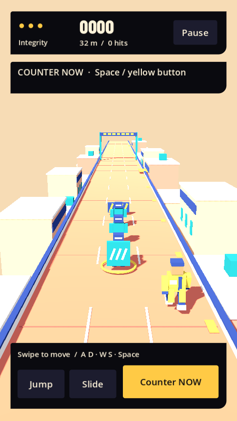
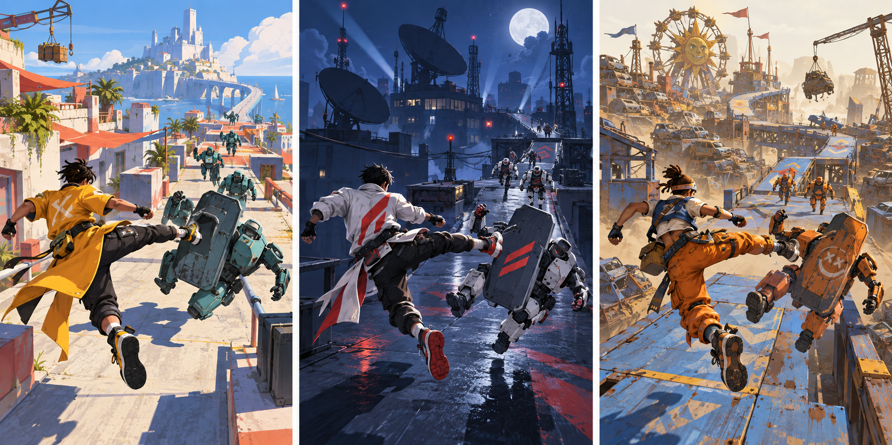
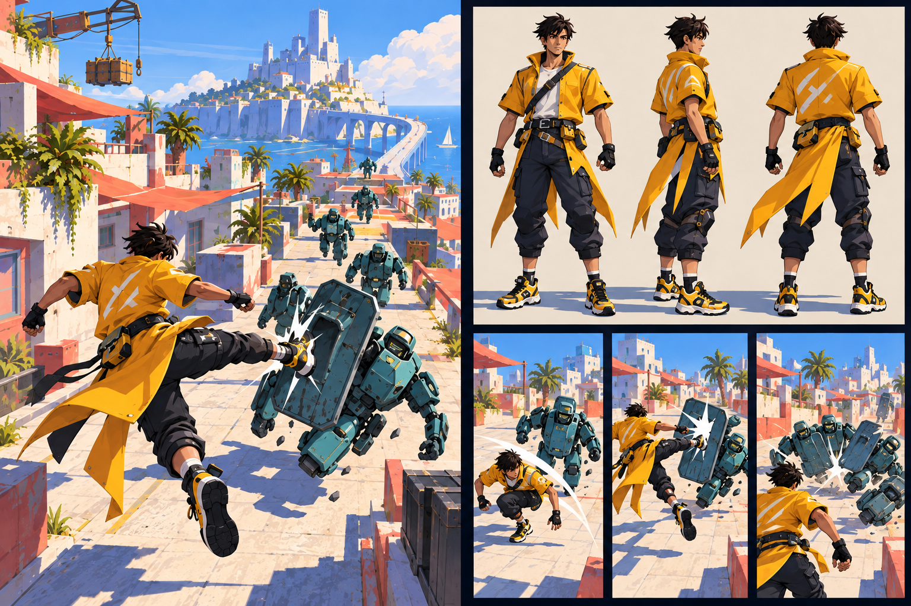

# BREAKRUN

A 3D combat-runner prototype. **Every enemy is a weapon.**

Sunbreak Riot is the working visual language: coral rooftop markets, cobalt shadow faces, a saffron courier and teal municipal robots. Astra-led design and implementation; generated concept images are references, not game screenshots.

## Development status

Playable foundation slice: title → run → shield dodge/counter → chain reaction → defeat/restart, with keyboard, mouse buttons and synthetic touch-input checks. See [foundation plan](docs/plans/001-foundation.md) and [full design proposal](docs/design/breakrun/PLAN.md). The original design proposal is preserved historically; its "no implementation" wording describes the earlier design-only delivery, not this repository.

The initial scene uses original procedural low-poly meshes. It is not the finished character art shown in the concept sheet. Bosses, upgrade choices, additional districts, replays, online features and store releases are not implemented in this foundation.

Local project path on the development Mac: `/Volumes/HARD/projects/breakrun`.

## Run from scratch

Install Godot **4.7.1 stable** standard edition (not the .NET edition; no .NET dependency). No package manager dependencies or paid services are required by the game.

```sh
cd /path/to/breakrun
godot --headless --path . --import --quit
godot --path .
```

If `godot` is not on PATH on macOS, use `/Applications/Godot.app/Contents/MacOS/Godot` instead. To edit, import `project.godot` in the Godot project manager and press F6/F5 after selecting the main scene/project. The renderer is GL Compatibility, with no bloom, volumetric fog or MSAA.

## Controls

- A/D or arrows: change lane.
- W/up: jump. S/down: slide.
- Space: counter a shield after dodging its bash.
- Escape: pause/resume.
- Touch: swipe on the track to move/jump/slide; use the separate Counter button to attack. UI touches must not also move the player.

Move out of the shield's marked lane during its bash, then counter from an adjacent lane while it recovers. A successful counter sends it back through its own checkpoint.

## Verify

```sh
python3 tools/verify.py
python3 tools/verify.py --render
```

Python 3 standard library only. Set `GODOT_BIN` if the executable is not on PATH. The runner enforces timeouts, scans engine logs for script errors even when exit code is zero, and requires assertion totals. The render option opens a real window, exercises the chain with input events, then saves PNGs and logs to ignored `artifacts/`.

On this Mac, double-click `Launch BREAKRUN.command` to play. After copying this project to another machine, run the import command first. The game auto-pauses when its window loses focus.

## Web build

```sh
godot --headless --path . --export-release Web
```

`export_presets.cfg` targets the no-threads Web export into `web/` with a custom shell in `web_shell/index.html` (progress loader, feature check, DPR-capped canvas sizing, side help panel, touch hints). The build is a static site deployable to any static host (`vercel.json` and `.vercelignore` in this repo target Vercel). Desktop tests do not prove every browser/GPU pair; mobile browser performance in particular is untested.

## Actual running build



The first shield is always in the middle lane. Leave that lane as it winds up, then press Space or Counter during the open-ring recovery. Counter score is 50; the two dummies award 100 each; the barricade awards 150. Jump and slide animate but are not yet tied to authored parkour obstacles. Runs intentionally reuse the same seed for reproducible playtesting.

## Layout

- `scripts/core/`: logical simulation and scoring, independent of rendering.
- `scripts/art/`: original opaque procedural meshes and environment palette.
- `scripts/input/`: touch gesture interpretation.
- `scripts/main.gd`: scene presentation, interface and input integration.
- `scenes/`: entry scene.
- `tests/`: headless logic and scene tests, rendered capture.
- `docs/design/breakrun/SKILL.md`: project-local development contract.
- `docs/design/breakrun/art/`: generated concept art and exact prompts.
- `docs/plans/`: implementation scope and milestone decisions.
- `artifacts/`: ignored local test logs and screenshots.

## Art direction





These are AI-generated concept illustrations. The in-game procedural art is a deliberately smaller first translation of the visual language. They do not imply finished models, rigs or animations.

Fonts: Barlow Condensed ExtraBold and Atkinson Hyperlegible Regular, bundled with their SIL Open Font License texts in `assets/fonts/`. See `docs/ASSETS.md`.

## Platform honesty

Desktop rendering and automated testing are the first target. Portrait layout is mobile-oriented, but that is not proof of Android/iOS installability, touch feel, thermal behavior or performance. No physical phone is selected or tested yet. No claim of commercial readiness or likely popularity is made.
